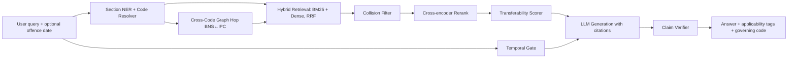

# LexBridge

**Code-aware, cross-code retrieval-augmented QA for India's 2024 criminal-law transition.**

On 1 July 2024 India replaced the IPC, CrPC and Evidence Act with the BNS, BNSS and BSA. Users now ask
in BNS terms, but decades of case law cite the IPC. Plain RAG breaks in four ways:

| Problem | Example |
|---|---|
| **Section-number collision** | IPC 302 = murder; **BNS 302 = wounding religious feelings** (BNS murder = 103) |
| **Cross-code gap** | A BNS 103 question needs IPC 302 precedent |
| **Transferability** | Some offences changed ingredients or punishment, or were dropped (IPC 377) |
| **Temporal applicability** | The offence date decides the governing code |

LexBridge adds five components:

- **C1** code-aware section resolver
- **C2** cross-code graph retrieval
- **C3** precedent transferability scoring
- **C4** temporal gate
- **C5** the LexBridge-QA benchmark kit

> ⚠️ **Not legal advice.** Mappings and fixture texts are unverified; check everything against the bare acts.

## Architecture



**Offline.** Statutes become `StatuteSection` records and mapping sources become `SectionMapping` rows
(merged, with disagreements written to `mapping_conflicts.csv`). Judgments go through NER and the C1
resolver, then role-aware chunking, then three stores: a dense index, a code-aware BM25 index (tokens
expanded with `ipc_302` IDs) and a NetworkX graph:

- `Judgment -CITES-> Section`
- `Section -MAPS_TO{change_type}-> Section`, plus the reverse `MAPPED_FROM` edge

**Online** (`LexBridge(res).answer(query, offence_date)`):

1. Resolve the query's sections (C1).
2. Pick the governing code family from the offence date (C4).
3. Hop across the transition, e.g. `BNS_103 → IPC_302 → judgments` (C2).
4. Retrieve with BM25 + dense + graph, fused by RRF (k=60).
5. Drop collision chunks.
6. Rerank to the top 8.
7. Tag each precedent's applicability (C3).
8. Generate the answer with `[doc¶n]` / `[CODE §sec]` citations and a dual citation.
9. Verify each claim against its cited text, regenerating once if needed.

**C1 rule priority:**

1. explicit code in the same phrase (0.98)
2. code mentioned within ±200 chars (0.85)
3. the document's dominant code (0.75)
4. document or offence date vs 1 July 2024 (0.70)
5. offence keywords vs section headings (≤0.60)
6. unresolved (0.20)

**C3 labels → tags:**

| Change type | Applicability tag |
|---|---|
| identical, reworded | DIRECTLY_APPLICABLE |
| punishment_changed, merged, split | APPLICABLE_WITH_CAVEAT |
| ingredients_changed | REVIEW_REQUIRED |
| omitted | NOT_APPLICABLE |

Rules decide first (no new section; diff ratio > 0.97; only the punishment clause differs). An LLM JSON
prompt handles the rest, and results are cached in `transferability.jsonl`.

## Setup

```bash
pip install -r requirements.txt && pip install -e .
```

Everything runs on CPU with **no downloads**, using seed and fixture data, a built-in TF-IDF embedder,
a passthrough reranker and a deterministic extractive `MockLLM`.

To use real components:

| Component | How |
|---|---|
| LLM | `ollama pull qwen2.5:7b-instruct` (auto-detected), or set `LLM_BASE_URL`, `LLM_API_KEY` and `LLM_MODEL` for any OpenAI-compatible API |
| Embeddings / reranker | `pip install -e ".[ml]"` and set `models.offline: false` in `configs/config.yaml` (bge-m3 → MiniLM; bge-reranker-v2-m3 → ms-marco MiniLM) |
| Real data | see [`data/README.md`](data/README.md) |

## Commands

```bash
make test        # 45 tests
make ingest      # → data/processed/*.jsonl, mapping_conflicts.csv
make index       # chunks, BM25 + dense index, graph, transferability cache, benchmark candidates
python -m lexbridge.generate.pipeline "Punishment for murder under Section 103 BNS?"
python -m lexbridge.generate.pipeline "What is the punishment under Section 302?" --date 2025-01-10
make api         # FastAPI :8000 — POST /ask, GET /section/{code}/{sec}, GET /map/{code}/{sec}
make demo        # Streamlit :8501 — includes the "collision demo" button (baseline vs LexBridge)
make eval        # all systems + ablations → results/*.json, paper/tables/{main,ablation}.tex
python -m lexbridge.eval.run_eval --system hybrid      # one system: lexbridge|no_rag|bm25|dense|hybrid|all
python -m lexbridge.eval.agreement data/benchmark/dummy_two_annotators.csv   # Cohen's κ
```

## LexBridge-QA (C5)

`benchmark/generate_candidates.py` fills `benchmark/templates.yaml` from the mapping table and the
fixture corpus. It produces 65 **draft** candidates in four categories (collision, cross_code_precedent,
temporal, transfer) and a stratified 50-question sample.

Gold documents come from hand-labelled `gold_sections` on the fixtures, never from the system's own
resolver. Annotation follows `benchmark/annotation_guidelines.md` with two annotators and κ ≥ 0.7.

## Results (pipeline check only)

> **These numbers are not research results.** They come from 14 synthetic judgments, 11 unverified
> mappings, a mock LLM, and a draft benchmark written alongside the system. They show that the pipeline
> and the metrics run, and that the fixtures exercise each failure mode.

| System | CER@5↓ | Code acc | R@5 | MRR | nDCG@5 | Transfer F1 | Temporal acc | Cit. P | Cit. R |
|---|---|---|---|---|---|---|---|---|---|
| No-RAG (simulated) | – | 0.558 | 0.000 | 0.000 | 0.000 | 0.176 | 0.286 | 0.000 | 0.000 |
| BM25-RAG | 1.000 | 1.000 | 0.729 | 0.626 | 0.582 | 0.176 | 0.286 | 0.343 | 0.679 |
| Dense-RAG | 0.923 | 0.977 | 0.695 | 0.631 | 0.577 | 0.176 | 0.214 | 0.329 | 0.633 |
| Hybrid-RAG | 1.000 | 1.000 | 0.714 | 0.637 | 0.577 | 0.176 | 0.286 | 0.336 | 0.643 |
| **LexBridge** | **0.000** | 1.000 | **0.957** | **0.986** | **0.961** | **0.942** | **1.000** | **0.881** | **0.867** |

The ablation table is in `paper/tables/ablation.tex`. Removing C1 or C2 brings collisions back
(CER 0.154), and removing C4 halves temporal accuracy. The `-verifier` row is identical to the full
system because the mock LLM is extractive, so every claim is already supported. Faithfulness is 1.0 for
the same reason.

Metrics:

- **CER@k:** share of collision questions with a wrong-code document in the top k.
- **Code acc:** whether the resolved query section matches gold.
- **R@k / MRR / nDCG@k:** document-level retrieval scores.
- **Transfer F1:** macro-F1 over applicability tags.
- **Temporal acc:** whether the governing code family is correct.
- **Cit. P / Cit. R:** cited documents vs gold documents.
- **Faith.:** verifier support rate. RAGAS is optional (`.[eval]`).

## Layout

```
configs/config.yaml       data/{raw,processed,seed,benchmark}/ + data/README.md
src/lexbridge/
  schemas.py config.py resources.py
  ingest/{statutes,mappings,judgments}.py
  nlp/{section_ner,code_resolver,rhetorical_roles,date_extractor}.py
  index/{chunker,dense,sparse,graph}.py
  retrieve/{hybrid,cross_code,rerank}.py
  transfer/{diff,transferability}.py
  generate/{llm,prompts,temporal_gate,pipeline,verifier}.py
  baselines/{no_rag,bm25_rag,dense_rag,hybrid_rag,common}.py
  eval/{metrics,run_eval,ablations,agreement}.py
  api/server.py  ui/app.py
benchmark/  scripts/01_ingest.sh … 04_run_eval.sh  tests/  paper/{main.tex,tables/}
```

## Limitations

- **Fixture data and a mock LLM.** Every number above checks the pipeline, not research performance.
  The No-RAG baseline is *simulated* as IPC-dominated parametric memory and must be re-run with a real LLM.
- **Unverified mappings.** The 11 seed mappings and the abridged statute texts are not verified against
  the bare acts. Mapping errors propagate directly into retrieval, collision filtering and applicability tags.
- **Draft gold labels.** Benchmark gold labels (including `draft_transfer_gold`) are drafts by the
  system author and need independent annotation. For example, the draft gold says IPC 302 → BNS 103 is
  DIRECTLY_APPLICABLE, but the C3 heuristic labels it `merged` (CAVEAT) because 103(2) is new.
- **Scope.** Criminal law only. Procedure under the BNSS savings clause is only flagged, not reasoned about.
  The rhetorical-role tagger is rule-based.
- **Not legal advice.**
