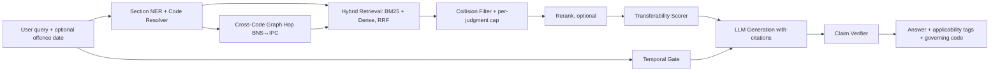

# LexBridge

**Code-aware, cross-code retrieval-augmented QA for India's 2024 criminal-law transition.**

On 1 July 2024 India replaced the IPC, CrPC and Evidence Act with the BNS, BNSS and BSA. Users now ask
in BNS terms, but decades of case law cite the IPC. Plain RAG breaks in four ways:

| Problem | Example |
|---|---|
| **Section-number collision** | IPC 302 = murder; **BNS 302 = wounding religious feelings** (BNS murder = 103) |
| **Cross-code gap** | A BNS 318 question needs precedent under IPC 415/417/418/420 |
| **Transferability** | Some offences changed ingredients or punishment, or were dropped (IPC 377) |
| **Temporal applicability** | The offence date decides the governing code |

LexBridge adds five components:

- **C1** code-aware section resolver
- **C2** cross-code graph retrieval
- **C3** precedent transferability scoring
- **C4** temporal gate
- **C5** the LexBridge-QA benchmark kit

> ⚠️ **Not legal advice.** Mappings are checked automatically against official texts, but no human has verified them.

## Architecture



### Offline

Statutes become `StatuteSection` records. Mapping sources are merged into `SectionMapping` rows, and each row is
checked automatically against the official texts. Judgments go through NER and C1, then role-aware chunking
(using a learned role tagger), then three stores:

- a dense index
- a code-aware BM25 index (tokens expanded with `ipc_302`-style IDs)
- a NetworkX graph: `Judgment -CITES-> Section`, `Section -MAPS_TO{change_type}-> Section`, plus the reverse `MAPPED_FROM`

### Online

`LexBridge(res).answer(query, offence_date)`:

1. Resolve the query's sections (C1).
2. Pick the governing code family from the offence date (C4).
3. Hop across the transition (C2), e.g. `BNS_318 → IPC_415/417/418/420 → judgments`.
4. Retrieve with BM25, dense and graph, fused by RRF.
5. Drop collision chunks, and keep at most 2 chunks per judgment.
6. Tag each precedent's applicability (C3).
7. Generate the answer with `[doc¶n]` / `[CODE §sec]` citations and a dual citation.
8. Verify each claim against its cited text.

### C1 (resolver v2)

Rules, in order:

1. explicit code in the same phrase
2. a *free* code mention within ±200 characters (mentions attached to another reference don't count)
3. date of the document or offence → code family; the family member is chosen by section existence,
   heading match, then a corpus prior `P(code | number)` counted from explicit citations
4. the document's dominant code
5. a code attached to a neighbouring reference
6. offence keywords vs section headings

### C3 labels → tags

| Change type | Applicability tag |
|---|---|
| identical, reworded | DIRECTLY_APPLICABLE |
| punishment_changed, merged, split | APPLICABLE_WITH_CAVEAT |
| ingredients_changed | REVIEW_REQUIRED |
| omitted | NOT_APPLICABLE |

Rules decide first. The LLM handles the rest, and sees the mapped sub-clause rather than the whole section.

## Two profiles

| | Sample (default) | Real |
|---|---|---|
| Config | `configs/config.yaml` | `LEXBRIDGE_CONFIG=configs/config.real.yaml` |
| Statutes | abridged fixtures | official India Code text: IPC 553, IEA 181, BNS 358, BNSS 531, BSA 170 sections |
| Mappings | 11 seed rows | 562 IPC→BNS rows (HF), automatically checked |
| Judgments | 14 synthetic | 2,955 real criminal judgments (eCourts, CC-BY-4.0): 1,491 decided before and 1,461 after 1 July 2024 |
| Models | TF-IDF embedder, mock LLM | MiniLM-L6 embedder, Qwen2.5-1.5B-Instruct (CPU) |
| Use | tests, demo, offline | experiments |

Sources and fetch steps are in [`data/README.md`](data/README.md).

## Setup and commands

```bash
pip install -r requirements.txt && pip install -e .
```

```bash
make test
```

```bash
make ingest && make index && make eval
```

```bash
make demo
```

```bash
python -m lexbridge.generate.pipeline "Punishment for murder under Section 103 BNS?"
```

What each one does:

- `make test` runs the tests (sample profile).
- `make ingest && make index && make eval` runs the sample pipeline end to end.
- `make demo` starts Streamlit on :8501 with the collision-demo button. `make api` starts FastAPI on :8000.

Real data, on CPU. You need `pip install torch --index-url https://download.pytorch.org/whl/cpu` and
`pip install sentence-transformers transformers datasets pypdf`.

```bash
python scripts/fetch_indiacode.py
```

```bash
python scripts/fetch_judgments.py 1500 1500 0,1,2,3,4,5,6,7
```

```bash
bash scripts/run_real.sh
```

```bash
bash scripts/run_real_eval.sh
```

The four scripts, in order:

1. `fetch_indiacode.py` downloads the official statutes into `data/raw/statutes/`.
2. `fetch_judgments.py` samples the eCourts judgments into `data/raw/judgments/overthelex/`.
3. `run_real.sh` handles ingest, the role tagger, the index, C3 with the LLM, the benchmark and the resolver evaluation.
4. `run_real_eval.sh` runs the test-split retrieval evaluation, ablations, significance tests and generation (about 1.5 h on 4 cores).

## Results on real data

**Benchmark.** LexBridge-QA has 470 silver questions in four categories, split 50/50 by question ID. All design
choices were made on **dev**; every table below is **test** (n = 215) unless noted.

**What the labels are.** Relevant documents are *silver*: judgments that cite the section **with an explicit
code** ("Section 302 IPC"). These labels don't depend on the resolver's inference rules, but **they favour
systems that use citation structure, as LexBridge does**. Human relevance judgments are needed before any of
this counts as a claim; the annotation sheets are ready in `data/benchmark_real/`.

### Retrieval (test, extractive generator)

| System | CER@5 ↓ | Code acc | P@5 | MRR | nDCG@5 | Temporal acc |
|---|---|---|---|---|---|---|
| BM25-RAG | 0.070 | 0.943 | 0.187 | 0.324 | 0.198 | 0.132 |
| Dense-RAG (MiniLM) | 0.000 | 0.952 | 0.087 | 0.186 | 0.099 | 0.132 |
| Hybrid-RAG | 0.047 | 0.948 | 0.150 | 0.271 | 0.159 | 0.132 |
| **LexBridge** | 0.047 | **0.995** | **0.626** | **0.790** | **0.665** | **1.000** |

Paired bootstrap against BM25 (5,000 resamples):

| Metric | Δ [95% CI] | p |
|---|---|---|
| P@5 | +0.439 [+0.393, +0.485] | < 0.001 |
| MRR | +0.466 [+0.405, +0.527] | < 0.001 |
| Code acc | +0.052 [+0.024, +0.086] | < 0.001 |
| Temporal acc | +0.868 [+0.791, +0.934] | < 0.001 |
| **CER@5** | −0.023 [−0.116, +0.070] | **0.40, not significant** |

On real data, collisions in the top 5 are rare for every system (n = 43 collision questions), because real
judgments usually name the offence in words. Per category, P@5 for LexBridge vs BM25 is:

| Category | LexBridge | BM25 |
|---|---|---|
| collision | 0.72 | 0.15 |
| cross-code precedent | 0.72 | 0.27 |
| temporal | 0.47 | 0.12 |

### Ablations (test)

| Variant | Code acc | P@5 | MRR | nDCG@5 | Temporal acc |
|---|---|---|---|---|---|
| full | 0.995 | 0.626 | 0.790 | 0.665 | 1.000 |
| −C1 resolver | 0.895 | 0.482 | 0.662 | 0.522 | 1.000 |
| −C2 graph hop | 0.995 | 0.390 | 0.666 | 0.431 | 1.000 |
| −C4 temporal gate | 0.914 | 0.556 | 0.701 | 0.590 | 0.516 |
| −role-aware chunking | 0.995 | 0.635 | 0.795 | 0.674 | 1.000 |
| −C3 / −verifier | identical to full | | | | |

- **C2** contributes the most, then **C1**, then **C4**.
- Role-aware chunking makes no measurable difference: it's slightly *worse*, within noise.
- C3 and the verifier don't change retrieval by design. C3 tags results, and the verifier edits answers, which
  the generation table measures. Transfer F1 is blank because transfer gold needs annotators.

### Generation (test subset, Qwen2.5-1.5B-Instruct on CPU)

This covers 60 test questions (20 each of collision, cross-code and temporal). Only the **LLM-written text** is
scored; LexBridge's templated header and dual-citation line are removed first.

| System | Names the right offence | …on collision questions | Sentences grounded in retrieved text | Code acc | Temporal acc |
|---|---|---|---|---|---|
| No-RAG (real LLM) | 0.267 | **0.00** | — | 0.820 | 0.233 |
| Hybrid-RAG | 0.400 | 0.05 | 0.610 | 0.940 | 0.233 |
| **LexBridge** | **0.767** | **0.70** | 0.607 | **1.000** | **1.000** |

- **Offence accuracy.** LexBridge beats hybrid by **+0.367 [+0.25, +0.50]** and No-RAG by **+0.50 [+0.38, +0.63]**,
  both p < 0.001 by paired bootstrap. Part of the gain is that LexBridge puts the governing statute text in the
  prompt, and the LLM uses it.
- **No-RAG confabulates.** It calls IPC 333 and IPC 352 "Fraudulent Representation" (they are grievous hurt to deter
  a public servant, and punishment for assault), and it refuses some questions as "political".
- **Citation format.** The 1.5B model uses the `[doc¶n]` format in only about 5% of answers. So the citation-based
  verifier, *faithfulness* and *citation P/R* can't be evaluated with this model. **The verifier and C3's effect on
  answers remain untested.** They need a 7B+ instruction-following model.
- **Grounding** is the same for both RAG systems (about 0.61).

### Component studies

**C1, masked-code evaluation.** I took 3,000 explicit references from held-out judgments, blanked the code
mention, and re-resolved:

| Resolver | Test accuracy |
|---|---|
| always IPC | 0.473 |
| date only | 0.770 |
| v1 (original) | **0.668** (worse than date only) |
| v2 | 0.772 |
| **v2 + corpus prior** | **0.867** |

The original window rule picked up codes attached to *neighbouring* references, so "Section 313 Cr.P.C."
leaked onto an adjacent IPC reference. Fixes were chosen on dev judgments; the prior is counted on dev only.

**Role tagger.** On the MARRO Indian rhetorical-role test set (2,602 sentences), macro-F1 is **0.116** for the
original rules and **0.669** for the learned TF-IDF + logistic-regression tagger. The rules were overfitted to the
synthetic fixtures.

**Reranker (dev).** The general-domain `ms-marco-MiniLM` cross-encoder cut LexBridge's dev P@5 from **0.664 to
0.346**, because it doesn't know which code is meant. It's off in the real profile (`rerank_mode: none`).
`bge-reranker-v2-m3` was measured at 0.7 pairs/s on this CPU and couldn't be tested.

**Mapping check.** Of the 562 HF rows, 508 are consistent with the official texts, 32 are suspect and 22 are
unchecked. The suspect rows include clear numbering errors in the source dataset, e.g. IPC 171A → BNS 169 (the
dataset says 206), and an off-by-one run across IPC 442–460. See `data/README.md`.

**First run, before the dev/test split** (`results/real/run1_pretuning/`, all 470 questions, reranker on,
narrower cross-code labels): LexBridge P@5 0.298 vs BM25 0.199. These are kept for transparency.

## Sample profile (fixtures)

The fixture pipeline (`make eval` → `paper/tables/{main,ablation}.tex`) uses 14 synthetic judgments and a mock
LLM. It's a regression check that each failure mode is exercised (for example, the BNS 302 collision demo).
**It is not evidence.**

## Layout

```
configs/{config,config.real}.yaml     data/{seed,benchmark,benchmark_real}/ + data/README.md
src/lexbridge/
  schemas.py config.py resources.py
  ingest/{statutes,mappings,judgments,verify_mappings}.py
  nlp/{section_ner,code_resolver,rhetorical_roles,role_classifier,date_extractor}.py
  index/{chunker,dense,sparse,graph}.py      retrieve/{hybrid,cross_code,rerank}.py
  transfer/{diff,transferability}.py         generate/{llm,prompts,temporal_gate,pipeline,verifier}.py
  baselines/  eval/{metrics,run_eval,ablations,agreement,resolver_eval,significance}.py  api/  ui/
benchmark/{templates.yaml,generate_candidates.py,export_annotation_sheets.py,annotation_guidelines.md}
scripts/{01..05,fetch_indiacode,fetch_judgments,run_real,run_real_eval}.*   tests/  paper/
```

## Limitations

- **No human annotation yet.** Relevance labels are silver, built from explicit citations, which advantages
  citation-based systems. Transfer gold is empty. The annotation sheets
  (`data/benchmark_real/annotation_sheet_{A,B}.csv`, `mapping_review.csv`) and the κ script are ready for two
  annotators.
- **CPU-scale models.** MiniLM instead of bge-m3; no reranker; a 1.5B LLM. Its C3 labels for 287 mappings and
  its answers are weak. Re-run on a GPU with bge-m3, bge-reranker and a 7B+ model.
- **Gaps in coverage.**
  - No CrPC text (India Code has only an unusable OCR scan).
  - No CrPC→BNSS or IEA→BSA mappings.
  - The IEEE mapping file, IL-TUR and InJudgements are gated or login-only and weren't used.
- **Unverified mappings.** They are automatically checked only. Errors propagate into retrieval and tags.
- **Corpus scope.** About 3,000 judgments sampled from row groups of one HF split, mostly High Courts.
- **Not legal advice.**
